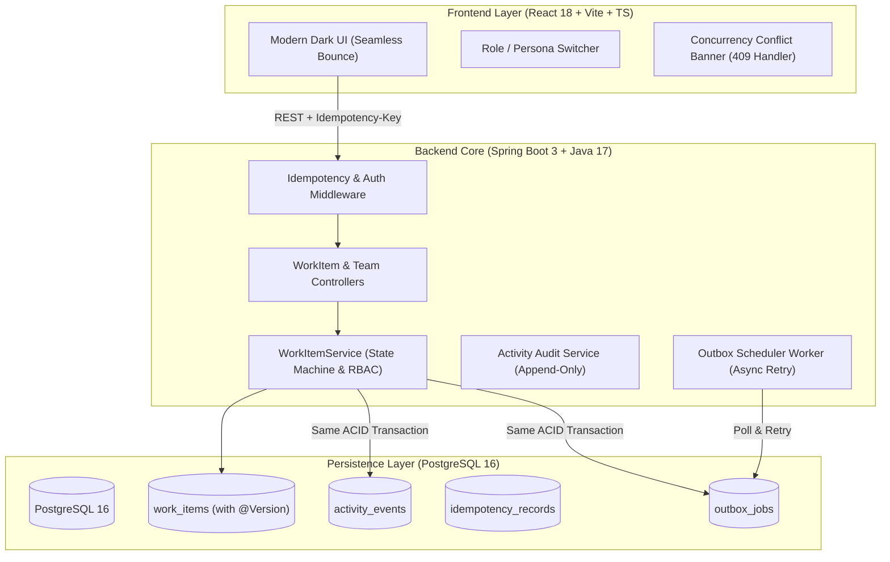

# Newtonite: Operations Under Pressure

An internal operations management platform engineered for high-pressure teams to coordinate, triage, and resolve operational work reliably under concurrent usage, network retries, and strict compliance authorization.

Built for the **Newtonite Software Engineering Assessment** by **Roll No: `2300971530064`**.

---

## 🏗️ Architecture Overview



---

## ⚡ The 5 Non-CRUD Critical Behaviors

1. **Atomic Concurrent Claim:** Prevents race conditions when two operators simultaneously claim an urgent unassigned issue. Uses conditional SQL updates (`WHERE assignee_id IS NULL`). The loser receives HTTP `409 Conflict`.
2. **Optimistic Locking (Stale Edits):** Uses JPA `@Version` tokens. Any mutation submitted against an outdated version is blocked with HTTP `409 Conflict`, prompting the user to sync with the latest server state.
3. **Idempotency Key Guard:** Protects mutating endpoints against network retries or accidental double-clicks using an `Idempotency-Key` header with cached response replay.
4. **Role-Enforced Workflow State Machine:** Server-enforced status transitions (`OPEN` → `IN_PROGRESS` → `AWAITING_APPROVAL` → `RESOLVED` → `CLOSED`). Crucially, approving transitions (`AWAITING_APPROVAL` → `RESOLVED`) requires **Team Lead** or **Admin** privileges; attempts by standard members yield HTTP `403 Forbidden`.
5. **Transactional Outbox Pattern:** Secondary actions (such as notifications) are committed as outbox jobs inside the primary ACID transaction, eliminating phantom events and delivering reliable at-least-once processing with retry backoff.

---

## 🚀 Quickstart & Prerequisites

### Prerequisites
- **Docker & Docker Compose** (Recommended for 1-command startup)
- Or **Java 17+ & Maven 3.9+** and **Node.js 18+** for local development.

### Running with Docker Compose (Recommended)
Clone the repository and run:
```bash
docker compose up --build
```
- **Frontend Dashboard:** [http://localhost:3000](http://localhost:3000)
- **Backend REST API:** [http://localhost:8080](http://localhost:8080)
- **PostgreSQL Database:** `localhost:5432` (Database: `newtonite_ops`, User: `newtonite`, Password: `newtonite_password`)

### Running Locally (Without Docker)

#### 1. Start PostgreSQL
Ensure PostgreSQL is running locally on port 5432 with database `newtonite_ops`, or use Docker for just the database:
```bash
docker run --name newtonite-postgres -e POSTGRES_DB=newtonite_ops -e POSTGRES_USER=newtonite -e POSTGRES_PASSWORD=newtonite_password -p 5432:5432 -d postgres:16-alpine
```

#### 2. Start Backend
```bash
cd backend
mvn spring-boot:run
```

#### 3. Start Frontend
```bash
cd frontend
npm install
npm run dev
```

---

## 👥 Seeded Demo Personas (Role Simulation)

The platform comes pre-seeded with 4 teams (*Engineering*, *Payments*, *Compliance*, *Operations*) and users in different roles. Use the **Persona Switcher** in the UI header to test permissions instantly:

| Name | Email | Team | Role | Purpose / What to Test |
| :--- | :--- | :--- | :--- | :--- |
| **Sarah Chen** | `sarah.chen@company.com` | Engineering | **LEAD** | Can approve `AWAITING_APPROVAL` tickets to `RESOLVED`. |
| **Alex Rivera** | `alex.rivera@company.com` | Engineering | **MEMBER** | Can create, claim, and work on tickets; cannot approve. |
| **Elena Rostova** | `elena.rostova@company.com` | Payments | **LEAD** | Lead for Payments team; can approve payment investigations. |
| **Marcus Vance** | `marcus.vance@company.com` | Compliance | **LEAD** | Lead for Compliance team. |
| **David Kim** | `david.kim@company.com` | Operations | **VIEWER** | Read-only access; mutations yield `403 Forbidden`. |
| **System Admin** | `admin@company.com` | Global | **ADMIN** | Superuser with cross-team privileges. |

---

## 🧪 Running Automated Tests

All tests are designed to execute with a single command and cover high-risk concurrency and authorization failure modes:

```bash
cd backend
mvn test
```

### Key Automated Tests Included:
- `ConcurrencyAndClaimTests`: Fires concurrent threads attempting to claim the same unassigned work item. Verifies that exactly one thread succeeds (200 OK) and all others receive `409 Conflict`.
- `OptimisticLockingTests`: Verifies that submitting an update with an obsolete version token fails with `409 Conflict` and leaves database state intact.
- `IdempotencyTests`: Sends duplicate requests with identical `Idempotency-Key` headers; confirms single record creation and identical cached responses.
- `WorkflowStateRulesTests`: Verifies that invalid state jumps are rejected (400 Bad Request) and non-Lead approval attempts return `403 Forbidden`.
- `ResourceAuthorizationTests`: Confirms that users cannot read or modify work items belonging to teams they do not belong to.

---

## 📋 Engineering Decisions & Trade-offs
Detailed architectural justifications, options evaluated, and trade-offs are documented in [**`ENGINEERING_DECISIONS.md`**](file:///C:/Users/hy180/projects/newtonite-ops-2300971530064/ENGINEERING_DECISIONS.md).

---

## ⚠️ Known Limitations
1. **Outbox Polling Delay:** Default polling interval is 5 seconds. In high-throughput production (>100k events/min), this should be augmented with PostgreSQL `LISTEN/NOTIFY` or Apache Kafka.
2. **Stateless JWT Tokens:** Authentication utilizes bearer tokens for quick demonstration. Revocation is handled on client logout rather than a distributed Redis blacklist.
3. **Search Engine:** Text filtering uses PostgreSQL indexing and case-insensitive matching; ultra-large volume search would benefit from OpenSearch/Elasticsearch.

---

## 🔭 "Next Week I Would..."
If given an additional week, the next engineering priorities would be:
1. **Real-time Server-Sent Events (SSE):** Push lightweight invalidation tokens to connected browsers to notify them of team changes without polling.
2. **Configurable Workflow Transition Builder:** Allow Team Leads to define custom multi-stage approval pipelines per work item type.
3. **Metrics & Tracing:** Instrument endpoints with OpenTelemetry and Prometheus metrics for tracking claim contention rates, lock wait times, and outbox queue lag.
